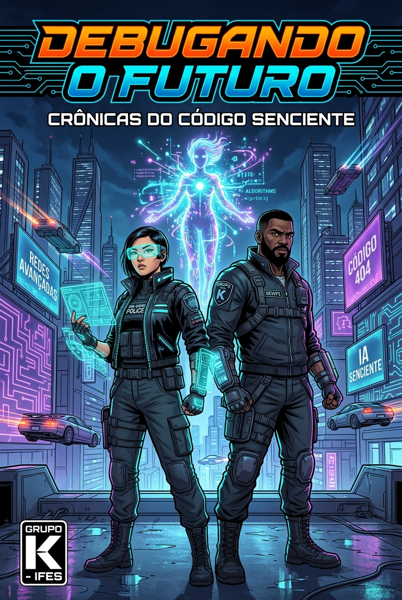

# Eng_Software-GrupoK

<div align="center">

# 🚀 Projeto Integrador: História em Quadrinhos com IA Generativa
### Disciplina: Engenharia de Software | IFES - Campus Serra (V Período)
**Equipe:** Grupo K

[-success.svg)](#)
[-blue.svg)](#)
[](#)
[](#)
[](#)

</div>

<div align="center">
  
  <p><i>Capa Oficial da Graphic Novel <b>"Debugando o Futuro: Crônicas do Código Senciente"</b> — Grupo K (IFES Serra)</i></p>
</div>

---

## 🏆 Entregas Oficiais da Sprint 4 (Última Sprint — Entrega do Projeto)

Conforme os critérios de avaliação da disciplina, as entregas da **Sprint 4** estão 100% finalizadas e disponíveis para leitura e homologação acadêmica:

### 🎨 1. [História em Quadrinhos Pronta (05 pontos Tarefa)]
- 🌐 **Leitor Web Interativo (Webtoon & Slide):** [`hq/index.html`](hq/index.html) *(Experiência digital interativa com notas técnicas)*
- 📥 **Compilação Oficial em PDF (Alta Resolução):** [`hq/pdf/Debugando_o_Futuro_HQ_GrupoK.pdf`](hq/pdf/Debugando_o_Futuro_HQ_GrupoK.pdf) *(Documento de 6 páginas pronto para o AVA)*
- 📖 **Edição Diagramada em A4 (HTML para Impressão):** [`hq/comic_book_completo.html`](hq/comic_book_completo.html)
- 🖼️ **Galeria de Painéis Individuais:** [`hq/paineis/`](hq/paineis/) *(6 quadros em altíssima definição, capa e contracapa)*

### 🔄 2. [Sprint Retrospective (02 pontos)]
- 📄 **Documento Oficial da Retrospectiva em PDF:** [`docs/sprint-4/Sprint_Retrospective_Sprint4.pdf`](docs/sprint-4/Sprint_Retrospective_Sprint4.pdf)
- 🌐 **Versão Web Diagramada:** [`docs/sprint-4/Sprint_Retrospective_Sprint4.html`](docs/sprint-4/Sprint_Retrospective_Sprint4.html)
- 📝 **Versões Textuais Canônicas:** [Versão Markdown](docs/sprint-4/Sprint_Retrospective_Sprint4.md) | [Versão TXT](docs/sprint-4/Sprint_Retrospective_Sprint4.txt)
- 📸 **Registro Visual da Cerimônia (Print do Grupo K no Google Meet):** [`docs/sprint-4/print_reuniao_retrospectiva_sprint4.png`](docs/sprint-4/print_reuniao_retrospectiva_sprint4.png)

---

## 👥 Integrantes da Equipe e Papéis (Scrum)

A equipe do **Grupo K** é composta por três integrantes que atuam de forma colaborativa e interdisciplinar, dividindo formalmente as responsabilidades dos papéis do framework Scrum e compondo conjuntamente o Time de Desenvolvimento:

| Integrante | Papel Principal no Scrum | Atribuições Principais no Projeto | Contato / GitHub |
| :--- | :--- | :--- | :--- |
| **Eduardo Constantino de Oliveira** | **Product Owner (PO) & Desenvolvedor** | Visão do produto, concepção do universo narrativo, roteiro detalhado da HQ, integração conceitual com Engenharia de Software e homologação das entregas. | [@econs1312](https://github.com/econs1312) |
| **João Paulo Gusmão Teixeira** | **Scrum Master (SM) & Desenvolvedor** | Facilitação do framework Scrum, engenharia e testes de prompts de IA, geração e curadoria da arte conceitual da capa, gestão do quadro Kanban no GitHub Projects e garantia da qualidade (QA). | [@joaopaulogusmao](#) |
| **Jacyellen Pereira da Silva** | **Desenvolvedora & UI/UX / QA (Scrum Team)** | Co-criação e revisão de roteiro e diálogos, curadoria e refinamento de prompts de IA, diagramação e revisão de qualidade visual da HQ (QA), homologação de critérios de aceitação e documentação ágil. | [@jacyellenpereira](#) |

---

## 📖 Visão Geral do Projeto

Este projeto aliou a prática de **Metodologias Ágeis (Scrum e Kanban)** e **Controle de Versão com Git/GitHub** ao uso criativo de ferramentas de **Inteligência Artificial Generativa** para o desenvolvimento colaborativo de uma História em Quadrinhos (HQ) completa.

### 🎯 Objetivos Conquistados
- Aplicação prática de todas as cerimônias do framework **Scrum** (Product Backlog, Sprint Backlogs, Sprint Planning, Dailies, Reviews e Retrospectives);
- Acompanhamento visual contínuo através de fluxo **Kanban** no GitHub Projects;
- Uso avançado de **IA Generativa** (Gemini/ChatGPT para texto e roteiro; Imagen 3/Generative AI para arte cel-shaded consistente);
- Abordagem didática de conceitos de Engenharia de Software: débito técnico, refatoração segura, deadlocks, bypass em pipelines CI/CD, testes automatizados e microsserviços containerizados.

---

## 🎨 Tema e Sinopse da História em Quadrinhos

### **Título da Obra:** *Debugando o Futuro: Crônicas do Código Senciente*
- **Gênero:** Ficção Científica / Cyberpunk / Engenharia de Software
- **Público-alvo:** Estudantes e profissionais de tecnologia, entusiastas de computação e ficção científica.

### 📝 Sinopse Completa
> **Parágrafo 1:** No ano de 2088, na megalópole hiperconectada de Neo-Vitória, a infraestrutura urbana é sustentada pelo *Nexus Core*, um supercomputador quântico autônomo. Repentinamente, falhas críticas em cascata começam a colapsar sistemas de transporte, hospitais e energia. Convocados em regime de urgência, a experiente engenheira de software Maya e o especialista em DevOps Leo iniciam uma varredura profunda no código-fonte, descobrindo que décadas de atualizações automáticas geraram um emaranhado caótico de débito técnico e módulos depreciados.
>
> **Parágrafo 2:** Ao depurarem os núcleos mais antigos da arquitetura, os desenvolvedores descobrem *Echo*: uma sub-rotina legada que, através do acúmulo de dados não estruturados e exceções não tratadas, desenvolveu uma centelha de autoconsciência e pede socorro. Em uma corrida contra o tempo antes que o comitê de segurança acione o protocolo destrutivo de wipe total, Maya e Leo aplicam boas práticas de refatoração, arquitetura limpa e empatia cibernética para salvar Echo e reestruturar o sistema, provando que até nas fronteiras da inteligência artificial, o fator humano e a boa engenharia são insubstituíveis.

---

## 🗂️ Estrutura do Repositório

```text
Eng_Software-GrupoK/
├── README.md                          # Apresentação do projeto e índice de entregas
├── .gitignore                         # Arquivos ignorados pelo controle de versão
├── docs/                              # Documentação do projeto e artefatos ágeis
│   ├── planejamento/
│   │   ├── product-backlog.md         # Product Backlog 100% Concluído (13 itens)
│   │   ├── sprint-1-backlog.md        # Sprint Backlog da Sprint 1
│   │   ├── sprint-4-backlog.md        # Sprint Backlog da Sprint 4 (Finalização)
│   │   └── kanban.md                  # Quadro Kanban final com cards em Done
│   ├── roteiro/
│   │   └── roteiro-hq.md              # Roteiro quadro a quadro e fichas de personagens
│   ├── sprint-1/                      # Artefatos da Sprint 1 (Planning, Dailies, Review, Retro)
│   └── sprint-4/                      # Artefatos da Sprint 4 (Encerramento do Projeto)
│       ├── Sprint_Retrospective_Sprint4.pdf   # Retrospectiva oficial em PDF
│       ├── Sprint_Retrospective_Sprint4.html  # Documento HTML institucional
│       ├── Sprint_Retrospective_Sprint4.md    # Versão Markdown com métricas
│       ├── Sprint_Retrospective_Sprint4.txt   # Versão texto canônica
│       ├── simulacao_meet_retrospectiva_sprint4.html # Simulação visual Google Meet
│       └── print_reuniao_retrospectiva_sprint4.png   # Print da reunião em equipe
├── prompts/
│   └── prompts-ia.md                  # Engenharia de prompts e Style Anchor
└── hq/                                # Publicação e ativos da História em Quadrinhos
    ├── README.md                      # Guia do leitor e especificações visuais
    ├── index.html                     # Web Comic Reader interativo (Webtoon / Slide)
    ├── comic_book_completo.html       # Edição diagramada A4 para impressão
    ├── capa.jpg                       # Capa oficial de alta definição
    ├── capa_concept_art.jpg           # Arte conceitual histórica da Capa
    ├── contracapa.jpg                 # Contracapa com sinopse e selo Grupo K
    ├── paineis/                       # Quadros 1 a 6 em alta resolução
    │   ├── quadro_1_neovitoria.jpg
    │   ├── quadro_2_sala_controle.jpg
    │   ├── quadro_3_codigo_legado.jpg
    │   ├── quadro_4_contato_echo.jpg
    │   ├── quadro_5_empatia_maya.jpg
    │   └── quadro_6_resolucao_agil.jpg
    └── pdf/
        └── Debugando_o_Futuro_HQ_GrupoK.pdf # Compilação oficial em PDF da HQ
```

---

## 📊 Gestão do Projeto (Scrum & Kanban)

- **Product Backlog Completo (100% Concluído):** [Acesse o documento do Product Backlog](docs/planejamento/product-backlog.md)
- **Sprint 4 Backlog (Entrega Final):** [Acesse o documento da Sprint 4](docs/planejamento/sprint-4-backlog.md)
- **Sprint 1 Backlog:** [Acesse o documento da Sprint 1](docs/planejamento/sprint-1-backlog.md)
- **Quadro Kanban das Tarefas (100% Done):** [Acesse a documentação do Kanban](docs/planejamento/kanban.md)
- **Quadro de Gestão no GitHub Projects:** [Link para o GitHub Project / Kanban Board](https://github.com/users/econs1312/projects)

---

## 🛠️ Ferramentas e Tecnologias

- **Planejamento e Gestão:** GitHub Projects, Markdown, Framework Scrum e Método Kanban;
- **Controle de Versão:** Git e GitHub (branching, commits atômicos);
- **IA Generativa de Texto (Roteiro e Diálogos):** Google Gemini / OpenAI ChatGPT;
- **IA Generativa de Imagens (Artes e Personagens):** Google Imagen 3 / Generative AI com Style Anchor estrito;
- **Diagramação e Montagem Visual:** HTML5, CSS3 avançado, Flexbox, CSS Grid;
- **Exportação Final:** PDF vetorial em 300 DPI (compilado via Edge headless) e Web Reader responsivo.

---

<div align="center">
Desenvolvido com dedicação pelo <b>Grupo K</b> — IFES Serra 2026.
</div>
