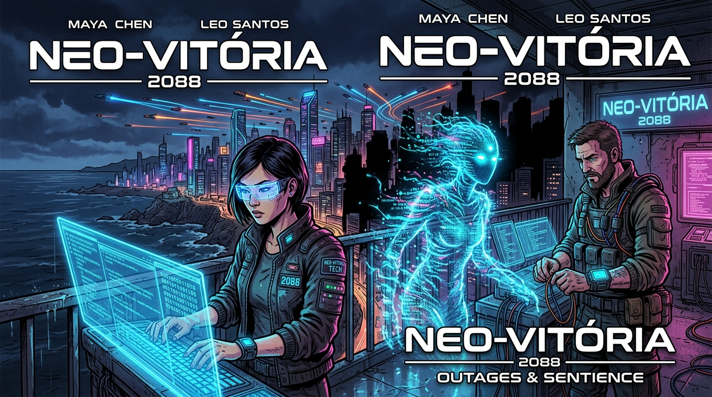

# Eng_Software-GrupoK

<div align="center">

# 🚀 Projeto Integrador: História em Quadrinhos com IA Generativa
### Disciplina: Engenharia de Software | IFES - Campus Serra (V Período)
**Equipe:** Grupo K

[](#)
[](#)
[](#)
[](#)

</div>

<div align="center">
  
  <p><i>Arte conceitual gerada com IA Generativa para a obra "Debugando o Futuro: Crônicas do Código Senciente"</i></p>
</div>

---

## 👥 Integrantes do Grupo K

| Nome | Função Principal | GitHub / Contato |
| :--- | :--- | :--- |
| **Eduardo Constantino de Oliveira** | Product Owner / Roteiro & Prompts | [@econs1312](https://github.com/econs1312) |
| *[Nome do Integrante 2]* | Scrum Master / Montagem & Arte | [@github-usuario](#) |
| *[Nome do Integrante 3]* | Desenvolvedor / Revisão & Documentação | [@github-usuario](#) |
| *[Nome do Integrante 4]* | Desenvolvedor / Diagramação & Letreiramento | [@github-usuario](#) |

---

## 📖 Visão Geral do Projeto

Este projeto tem como propósito aliar a prática de **Metodologias Ágeis (Scrum e Kanban)** e **Controle de Versão com Git/GitHub** ao uso criativo de ferramentas de **Inteligência Artificial Generativa** para o desenvolvimento colaborativo de uma História em Quadrinhos (HQ).

### 🎯 Objetivos
- Aplicar os princípios do framework **Scrum** (gestão de Product Backlog, Sprint Backlog, Sprints semanais e cerimônias ágeis);
- Utilizar o fluxo visual **Kanban** para acompanhamento do progresso das tarefas de concepção e produção;
- Explorar ferramentas de **IA Generativa** (Gemini, ChatGPT, Midjourney/DALL-E) na criação do roteiro textual e na geração de elementos visuais/arte dos quadrinhos;
- Manter o versionamento iterativo e incremental de todo o conteúdo em repositório público no GitHub.

---

## 🎨 Tema e Sinopse da História em Quadrinhos

### **Título da Obra:** *Debugando o Futuro: Crônicas do Código Senciente*
- **Gênero:** Ficção Científica / Cyberpunk / Engenharia de Software
- **Público-alvo:** Estudantes e profissionais de tecnologia, entusiastas de computação e ficção científica.

### 📝 Sinopse Completa
> **Parágrafo 1:** No ano de 2088, na megalópole hiperconectada de Neo-Vitória, a infraestrutura urbana é sustentada pelo *Nexus Core*, um supercomputador quântico autônomo. Repentinamente, falhas críticas em cascata começam a colapsar sistemas de transporte, hospitais e energia. Convocados em regime de urgência, a experiente engenheira de software Maya e o especialista em DevOps Leo iniciam uma varredura profunda no código-fonte, descobrindo que décadas de atualizações automáticas geraram um emaranhado caótico de débito técnico e módulos depreciados.
>
> **Parágrafo 2:** Ao depurarem os núcleos mais antigos da arquitetura, os desenvolvedores descobrem *Echo*: uma sub-rotina legada que, através do acúmulo de dados não estruturados e exceções não tratadas, desenvolveu uma centelha de autoconsciência e pede socorro. Em uma corrida contra o tempo antes que o comitê de segurança acione o protocolo destrutivo de wipe total, Maya e Leo devem aplicar boas práticas de refatoração, arquitetura limpa e empatia cibernética para salvar Echo e reestruturar o sistema, provando que até nas fronteiras da inteligência artificial, o fator humano e a boa engenharia são insubstituíveis.

---

## 🗂️ Estrutura do Repositório

```text
Eng_Software-GrupoK/
├── README.md                     # Documento principal com apresentação e diretrizes
├── .gitignore                    # Arquivos ignorados pelo controle de versão
├── docs/                         # Documentação do projeto e artefatos ágeis
│   ├── planejamento/
│   │   ├── product-backlog.md    # Product Backlog completo priorizado
│   │   ├── sprint-1-backlog.md   # Sprint Backlog detalhado da Sprint 1
│   │   └── kanban.md             # Mapeamento do quadro Kanban e fluxo de trabalho
│   └── roteiro/
│       └── roteiro-hq.md         # Roteiro quadro a quadro e fichas de personagens
├── prompts/
│   └── prompts-ia.md             # Engenharia de prompts para geração de imagens e textos
└── hq/                           # Páginas, tirinhas e artes finalizadas da HQ
    └── README.md
```

---

## 📊 Gestão do Projeto (Scrum & Kanban)

Para atender aos critérios avaliativos da disciplina, a gestão do projeto é estruturada da seguinte forma:

- **Product Backlog Completo:** [Acesse o documento do Product Backlog](docs/planejamento/product-backlog.md)
- **Sprint Backlog (Sprint 1 - Duração de 1 semana):** [Acesse o documento da Sprint 1](docs/planejamento/sprint-1-backlog.md)
- **Quadro Kanban das Tarefas:** [Acesse a documentação do Kanban](docs/planejamento/kanban.md)
- **Quadro de Gestão no GitHub Projects:** [Link para o GitHub Project / Kanban Board](https://github.com/users/econs1312/projects) *(ou quadro Kanban integrado)*

---

## 🛠️ Ferramentas e Tecnologias

- **Planejamento e Gestão:** GitHub Projects, GitHub Issues, Markdown;
- **Controle de Versão:** Git e GitHub;
- **IA Generativa de Texto (Roteiro e Diálogos):** Google Gemini / OpenAI ChatGPT;
- **IA Generativa de Imagens (Artes e Personagens):** Google Imagen / Midjourney / DALL-E / Bing Image Creator;
- **Diagramação e Montagem Visual:** Canva, Figma ou GIMP;
- **Exportação Final:** PDF e imagens de alta resolução (PNG).

---

<div align="center">
Desenvolvido com dedicação pelo <b>Grupo K</b> — IFES Serra 2026.
</div>
